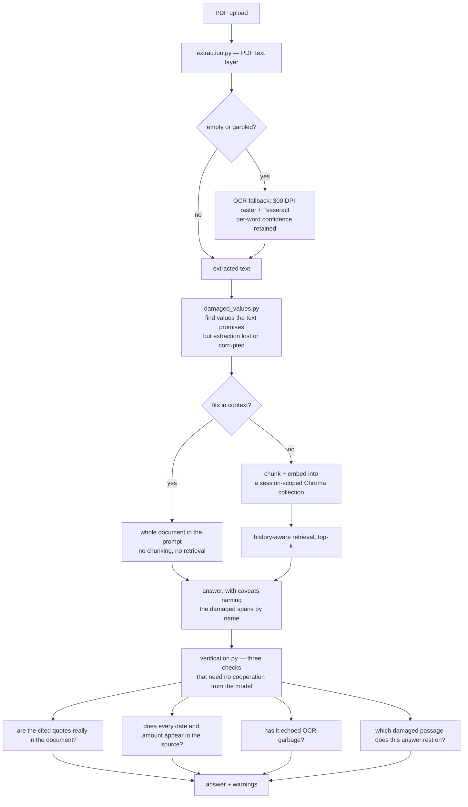
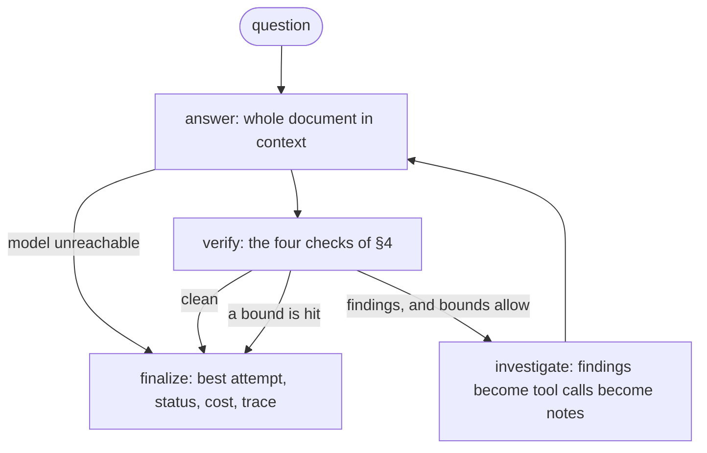

# ⚡ InsightStream RAG
**High-Performance Document Intelligence & Parallel Orchestration**

InsightStream RAG is a **Retrieval-Augmented Generation (RAG)** engine built around the
problems that show up in real document work rather than in tutorials: extraction that
fails silently, values that OCR destroys without telling you, answers you can't trace
back to the source, and latency on multi-part analysis.

**What this is:** a working demonstrator for question-answering over difficult real-world
PDFs — scanned, right-to-left, and sometimes carrying a text layer that decodes to
confident nonsense. Its distinguishing idea is that it *measures how badly extraction
damaged the document* and checks every answer against that damage, instead of assuming
the text it indexed is the text that was printed.

**What this is not:** a product. It runs single-tenant and in-memory by design, has no
authentication, no persistence and no rate limiting beyond a concurrency cap. Where a
technique doesn't earn its place it isn't used — the résumé path deliberately skips both
retrieval and parallelism. Its claims are backed by a benchmark and an eval you can run,
and its limitations are written down next to them, including the ones that are still
unfixed.

## 🧭 How It Fits Together



The shape worth noticing: **damage detection happens before routing, and verification
happens after generation.** Both sit outside the model, because the failures they catch
are ones the model cannot be prompted out of — see §4.

| Module | Responsibility |
|---|---|
| `app.py` | Streamlit UI, session state, prompt assembly, the two answering paths |
| `extraction.py` | Text layer → garbled-text detection → OCR fallback with per-word confidence; bidi stripping; tiny-chunk filtering; the context-size routing decision |
| `damaged_values.py` | Finds passages promising a value that extraction lost or corrupted |
| `verification.py` | Quote checking, date/amount checking, garbage echoes, damage provenance |
| `resume_analysis.py` | The one path that deliberately uses neither retrieval nor parallelism |
| `analysis_sets.py` | Per-document-type question sets for the parallel analysis |
| `eval_rag.py`, `eval_fixtures.py` | Golden-set evaluation across indexing configurations |
| `benchmark_parallelism.py` | Parallel-vs-sequential measurement with order-bias controls |
| `answering.py` | Full-context answering, lifted out of `app.py` so the agent can import it without Streamlit |
| `agent_graph.py`, `agent_state.py` | The verification loop as a LangGraph graph: bounded retry, best-of, checkpointing |
| `agent_tools.py` | Three read-only tools (search, read page, re-read a page) with strict schemas; a re-read counts only when two reads agree |
| `agent_llm.py`, `cost_tracking.py` | The OpenAI answerer (backoff + model fallback) and per-call token/cost accounting |
| `run_agent.py` | CLI for the agent: budget, checkpoints, resume, purge |
| `test_*.py` | Deterministic tests; `test_damage_regression.py` replays three real failures |
| `main.py` | A standalone CLI sanity harness, predating the extraction work — **not** the entry point and without the OCR path |

## 🚀 The Core Advantage: RAG vs. Vanilla LLM
Modern LLMs have large context windows but remain prone to hallucination and offer no
traceability. InsightStream grounds every answer in retrieved passages and shows them
alongside the response, so each claim can be checked against the source text. Grounding
reduces hallucination — it doesn't eliminate it, which is why the evidence is always one
click away rather than hidden.

## 🛠️ Technical Challenges & Engineering Solutions

### 1. High-Throughput Parallel Orchestration
Analysing a long document means asking several unrelated questions of it, which is slow
one at a time.
*   **The Fix:** `asyncio.gather` fires the question set concurrently, behind an
    `asyncio.Semaphore` that caps fan-out to respect API rate limits.
*   **Why separate calls:** each question needs *different chunks* — "payment terms" and
    "termination conditions" live in different parts of a contract — so one shared
    retrieval would serve all of them badly. The concurrency is architectural, not
    decorative.

### 2. Extraction That Fails Loudly, Not Silently
Text extraction can fail in two ways: returning nothing (scanned/image-only PDFs), or —
far worse — returning confident nonsense.
*   **The Finding:** a Hebrew contract whose embedded font carries no usable `ToUnicode`
    CMap decodes to plausible-looking ASCII mojibake. PDFMiner, pypdf and PyMuPDF all
    produce the *same* garbage, so no choice of loader fixes it. The file renders
    perfectly on screen, because rendering draws glyphs and never consults that table.
*   **The Fix:** a heuristic detector flags corrupted text layers, and extraction falls
    back to OCR — PyMuPDF rasterises each page at 300 DPI and Tesseract reads the pixels,
    bypassing the PDF's font structures entirely. If both paths fail, the app says so
    rather than embedding garbage and answering from it.

### 3. Knowing What OCR Destroyed
Extraction is the only stage where information *enters* the system. Everything downstream
can preserve or flag it; nothing downstream can recover it. So the pipeline measures the
damage rather than hoping there is none.

*   **Per-word confidence.** OCR reads through `image_to_data`, not `image_to_string`, so
    Tesseract's own per-word confidence survives. Tokens below 60% are named to the model
    as untrustworthy and listed in the UI. On the reference contract: 87.7% mean, 68
    tokens flagged.
*   **Why that is not enough, structurally.** On that same document a misread that
    destroyed a contractual date scored **82** — the engine was confidently wrong — and
    the date itself scored *nothing*, because it produced no token at all. Confidence is a
    property of an emitted token; a deletion emits nothing, so no threshold can reach it.
    Lowering the cutoff flags half the document and still misses it.
*   **So damage is detected structurally too** (`damaged_values.py`): a connector that
    promises a date (`החל`, `מיום`, `עד ליום`) with no date after it **and** evidence of
    damage in the gap — Latin characters in Hebrew prose, a low-confidence token, a bare
    structureless number. Two signals are required; one alone flags correct Hebrew
    constantly, since `מיום שנדרש` ("from the day required") is an ordinary phrase.
*   **What this does not catch, measured.** On a second contract the detector found
    nothing — and that was a miss, not a pass. OCR had deleted a payment date there too,
    leaving the same debris, but `ביום`, `מיום`, `ליום` and `בתאריך` appear *zero* times
    in that document's extracted text: the connectors were destroyed along with the
    values. The rule assumes the grammar survives even when the value does not, and the
    anchor words are short function words — exactly what OCR misreads most. Widening the
    word list does not help when no word survived, which is why the roadmap's fix is at
    extraction rather than in this heuristic.
*   **Bidi controls are stripped** from OCR output. `image_to_string` wraps Latin runs
    inside Hebrew lines in LRM/RLM marks — presentation hints that this app decides at
    render time anyway, and an invisible mark landing inside a date silently breaks the
    substring matching the verification layer depends on.

### 4. Verifying the Answer, Not Trusting It
Prompting proved insufficient three times over on one clause. Told nothing, the model
fabricated a date. Told values may be illegible, it passed OCR garbage through. Told
exactly which passages were damaged, it invented a fluent, plausible substitute with
nothing wrong-looking in it at all.

Each constraint made the failure *quieter*, not rarer. So three checks run after the
model, none of which need it to cooperate:

*   **`verify_quotes`** — does each cited passage actually appear in the document?
*   **`verify_answer_facts`** — does every date and amount in the answer appear in the
    source? (Dates are compared as `(day, month, year)`, so `4/11/2027` and `4.11.2027`
    match — a check that flags correct values is worse than no check.)
*   **`find_ocr_garbage_echoes`** and **`answer_rests_on_damage`** — has the answer copied
    OCR gibberish, and which flagged passages does it reproduce?

That last one answers **provenance**, and it is the only thing that catches the third
failure. Presence is not provenance: `verify_answer_facts` confirms a value appears
*somewhere*, and in this contract the date `3.9.2027` is printed for a payment — so a
date guessed for a different clause would have been confirmed against real text from an
unrelated section.

### 5. Retrieval Only Where It Earns Its Place
RAG is the wrong tool for a short document. Chunking a two-page CV and retrieving top-k
discards information, and "which skills are missing?" is unanswerable from partial text —
the model can't distinguish *absent from the document* from *absent from the chunks I
retrieved*.
*   **The Fix:** long documents fan out into parallel, independently-retrieved questions.
    The résumé path deliberately uses **neither** retrieval nor parallelism: one call, the
    complete document in context, a structured (Pydantic) result.

### 6. Adaptive Indexing Strategy
Data density varies by document type — a dense résumé versus a sprawling legal contract.
*   **The Fix:** a single **Document Type** control drives both halves of the pipeline:
    indexing (**Chunk Size**, **Overlap**, **Retrieval Depth k**) and analysis (which
    question set runs). A contract wants contract-shaped chunking *and* contract-shaped
    questions; they aren't independent choices.

### 7. Stateless & Privacy-First Architecture
*   **Zero-Storage Policy:** uploads exist only in ephemeral memory for the session. The
    temp file the loader needs is deleted in a `finally` block, so nothing is left on disk.
*   **Isolated Vector Collections:** each browser session gets a ChromaDB collection keyed
    to a session UUID — never the filename — so two users uploading `resume.pdf` never
    share indexed data.
*   **On-Demand Teardown:** the **🔥 Incinerate** control deletes the active collection and
    resets the session, so the data is gone when you say so rather than when the process
    restarts.

## 🤖 Verification Agent (LangGraph)

`verification.py` already knows when an answer is wrong. Until now that knowledge ended in
a warning badge. The agent turns it into a **bounded retry**: the failed answer's findings
become evidence (tools re-read the document), the model answers again, and the same checks
run again.



**It stops three ways, and never silently.** `max_attempts` (default 3); a per-question
cost budget, checked *before* paying for another attempt (default $0.05, a guard rail, not
a target); and a no-progress rule — identical findings two attempts running means a third
will not differ. Hitting a bound returns the *best* attempt (fewest findings, latest on a
tie, so a retry that made things worse is not what you see) with `status="degraded"` and the
unresolved findings listed. An answer that failed its checks is never relabelled as fine.

| Status | Meaning |
|---|---|
| `verified` | every check passed |
| `degraded` | best answer returned **with** unresolved findings |
| `budget_exceeded` | stopped retrying to stay inside the budget |
| `failed` | the model could not be reached at all (returned as a result, not a traceback) |

**Tools** (`agent_tools.py`): `search_document`, `read_page`, and `reocr_page`, which
re-reads one page from its pixels at a resolution, Tesseract page-segmentation mode (`psm`)
or black-and-white `threshold` you choose (the pipeline's own read is 300 DPI). All are
read-only, have strict Pydantic schemas, and never raise: bad arguments, a missing
Tesseract or an unmapped page come back as `ok=False`, costing the agent one piece of
evidence rather than the run. Page numbers exist only for OCR extraction (the text layer
arrives as one undifferentiated document), and the tools refuse rather than guess one.

**A re-read is evidence, not authority.** `probe_reread.py` was written to test whether
re-reading a damaged page recovers a lost value, and its first result on a real contract page
(one page, one file) was negative twice over: the date that had been lost stayed lost at 300,
400 and 600 DPI, and a date that *had* been read correctly was misread at 400 DPI. An earlier
version of the agent added every re-read to the verification corpus, which would have let that
one misread pass the fact check as "present in the document". Now a single re-read is never
added. The agent reads a damaged page at two further resolutions (400 and 600 DPI), and a date
or amount joins the corpus only if **both** reads produce it and the original page lacked it.
The re-read *text* is never added, so a quote found only there is still flagged. When the reads
do not agree, the model is told the damaged value is illegible.

**State and privacy.** The document is *not* in graph state — state is what a checkpointer
writes, and this project promises not to persist uploads. Checkpointing is opt-in
(`--checkpoint-db`); what it writes is the per-question derivative (question, answer,
quotes, findings, notes, cost), and `purge_thread` deletes it. A crashed run resumes from
its last checkpoint *without calling the model again*. One thread per question, so retries
never leak between questions; conversation history is passed in, as in the app.

**Cost and latency.** Every model call reports usage through a callback; the total lives in
state, so a resumed run continues the same bill. A model with no price entry, or a call that
reported no usage, is flagged `cost_complete=False` — never shown as free. Each node's time
is in the trace. The price table in `cost_tracking.py` is configuration: the one figure in
it was read from a third-party aggregator (llmreference.com, page dated 2026-10-17), not
from OpenAI — check it before quoting a cost.

```bash
python run_agent.py contract.pdf "מתי הפינוי?"                       # prints answer, status, cost, trace
python run_agent.py contract.pdf "..." --budget 0.02 --attempts 2
python run_agent.py contract.pdf "..." --checkpoint-db agent.sqlite --thread q1
python run_agent.py contract.pdf --resume q1 --checkpoint-db agent.sqlite
python run_agent.py contract.pdf --purge q1 --checkpoint-db agent.sqlite
```

**What this does not do, stated plainly:**
- Its value is **only barely measured**. The tests use a scripted answerer, so the loop's
  *mechanics* are proven; its *value* rests on a few live runs against gpt-4o-mini, summarised
  in "What the live evals showed" below. In short: no harm found, one real fix, and a sample far
  too small to quote a rate.
- Full-context documents only. Larger documents go through retrieval, which the agent does
  not cover; `build_agent` refuses them with a reason.
- The investigate step is **rule-driven** (findings map to tool calls), not a model choosing
  tools. Cheaper and testable, less flexible. The tools are real LangChain `StructuredTool`s,
  so a model-driven policy can replace it without touching the rest.
- Whether a re-read can ever recover a value that OCR *deleted* is **unproven**: on the one real
  page tested it could not, at three resolutions. `probe_reread.py` with `--psm` and
  `--threshold` tests other ways of reading the same pixels; if none works, the case for a second
  OCR engine (see the roadmap) is the stronger one. A value a re-read does recover can still
  leave a provenance warning, because the answer overlaps a passage the first extraction
  damaged. That is conservative, not wrong.
- Not wired into the Streamlit UI yet; it runs from the CLI.

### Long-term memory: which retries actually work

State (`agent_state.py`) lives for one question. The one thing worth carrying *between* questions
is how often a retry resolved each kind of finding, because that changes behaviour: if retries on a
kind almost never help, the loop stops paying for them and reports `degraded` at once
(`stop_reason: hopeless`, with the numbers in the warning).

```bash
python run_agent.py contract.pdf "..." --memory-db memory.sqlite   # learn and use
python run_agent.py --memory-db memory.sqlite --memory-stats        # per kind: tries, fixed, rate
python run_agent.py --memory-db memory.sqlite --forget-memory       # wipe it
```

- **What is stored:** counters per (scope, finding kind): `tries`, `fixes`, `hopeless`. No question,
  answer, quote, document text, page or file name. Kinds come from a fixed list of four; anything
  else is ignored. A test dumps the database and the raw file bytes and searches them.
- **It cannot starve itself:** nothing is judged before 10 tries of a kind, and every 10th hopeless
  run retries anyway, so the numbers can still move.
- **Not recorded:** runs with no retry, runs that ended in a model error, and clean first answers.
- **Honest status:** the thresholds (10 tries, 10% fix rate, probe every 10) are starting guesses,
  not measured. It has only run against a scripted model. Read `--memory-stats` after real use and
  see whether the picture is sensible before trusting the policy.

### What the live evals showed

All on invented documents, gpt-4o-mini, 17 clean questions and the earlier 6-document damaged suite (14 questions; the suite now has 13 documents).
The scorer was widened twice after seeing live results (the prompt's own "does not show it legibly" sentence is now an honest answer). Treat every number as "this happened", not "this is the rate": the samples are 1 to 5 questions,
and temperature 0 is **not** deterministic on the API (one refusal in an early run never reproduced).

- **Clean text:** one attempt and the loop both answered 17/17; the loop added about 2.5% cost.
- **Damaged, answer lost (5 questions):** one attempt copied the OCR debris (`DYN 6`) into its answer
  once, in the original reproduction, and admitted the value was unreadable in the other four. The
  loop fixed the one, in 2 attempts, for about 27% more cost per question and 0.1s. It broke nothing.
- **The damage caveat itself** (`eval_caveat.py`, three repeats, no agent): without it the model
  invented or echoed on 6 of 15 damaged runs, with it on 3 of 15. So the caveat earns its place.
  The same 3 are the original document, which echoes the debris under **every** prompt tried; only
  the loop fixed it. The two mechanisms cover different failures.
- **What the caveat costs:** one refusal of an answerable question in 24 control runs (it did not
  repeat), and on one "damage nearby, answer intact" question the current wording picked the wrong
  part of the clause. A narrower wording (`damage_caveat_narrow`, a candidate, not used by the app)
  got that question's content right but still copied the debris, and was no better on damaged
  questions. It was **not adopted**; the difference does not support changing the prompt.
- **Not tested:** re-reading a page (these documents have no PDF behind them), larger samples,
  other models, more than one kind of damage beyond a lost date.
- **The scorer** knows only failures already seen, and several "honest" answers are the prompt's own
  stock sentence ("does not show it legibly"), which the caveat tells the model to say. Read the
  answers (`--json`) rather than the counts.

## 📊 Performance Benchmarks
`benchmark_parallelism.py` sweeps fan-out from 2 to 10, running the *identical* question
set both ways so exactly one variable changes. Seven reps per level, medians:

| Fan-out | Sequential | Parallel | Speedup | Efficiency |
|---|---|---|---|---|
| 2 | 3.31s | 1.90s | 1.74× | 87% |
| 5 | 9.49s | 2.97s | 3.20× | 64% |
| 10 | 16.17s | 3.97s | 4.07× | 41% |

**Efficiency decays for two compounding reasons, and neither is Amdahl's law** — there is
no serial fraction here, the calls are fully independent. Below the concurrency limit,
wall-clock equals the *slowest* call, so efficiency is `mean ÷ max` of the batch and the
expected maximum grows with N. Above the limit, throughput binds as well: N calls
pipeline through 5 slots.

An earlier version of this benchmark reported a 3.02× speedup on a two-call batch — an
efficiency of 151%, which is definitionally impossible, since you cannot beat running
every call at once. The cause was arm ordering: sequential always ran first and warmed the
connection for parallel. The runner now alternates arm order, warms up per level, and
flags any row exceeding its own ceiling as `INVALID` rather than printing it as a result.

## 🔬 Evaluation
`eval_rag.py` runs 17 golden questions against a synthetic contract across five indexing
configurations, scoring retrieval hit, answer correctness (both deterministic against
known ground truth) and groundedness (LLM-as-judge) *separately*:

| Config | chunk | k | Retrieval | Correct | Grounded |
|---|---|---|---|---|---|
| control-tiny | 200 | 2 | 82% | 76% | 100% |
| Technical/Code | 600 | 10 | 100% | 100% | 100% |
| Legal/Book | 800 | 7 | 100% | 100% | 100% |
| General | 1000 | 5 | 88% | 88% | 100% |
| Résumé | 1500 | 3 | 82% | 82% | 100% |

**`k` predicts the score; total context size does not.** Ordered by `k` the results are
monotonic (2→76%, 3→82%, 5→88%, 7→100%, 10→100%), yet the control saw 400 characters of
context and scored *below* the Résumé preset's 4,500. Each answer lives in one place, so
what matters is whether that place lands in the top-k — more shots at the target, not
bigger shots. On a contract corpus, raise `k` before you raise chunk size.

**Groundedness stayed at 100% even on wrong answers**, which is the metric working and
showing its own limit: when retrieval returns the confidentiality clause and the model
faithfully answers from it, that answer *is* grounded — just not in the right clause.
Faithfulness is not correctness, which is why they are scored apart.

*Caveat:* 17 questions on one synthetic document is a smoke test, not a benchmark.

## ✅ Tests
Everything except `smoke_resume.py` is deterministic and needs no API key:

```bash
python test_verification.py        # 29 cases — quotes, dates, garbage echoes, provenance
python test_damaged_values.py      # 10 cases — damage detection vs. correct Hebrew prose
python test_damage_regression.py   # the three failure modes of §4, each still caught
python test_cost_tracking.py       # 12 cases — pricing, unpriced calls, all-or-nothing totals
python test_agent_tools.py         # 58 cases — tools, schemas, corroboration, a real Tesseract re-read
python test_agent_graph.py         # 80 cases — every way the loop can fail, resume, privacy, CLI
python test_probe_reread.py         # 25 cases — the re-read experiment's report, checked against known pages
python test_quote_debris.py         # 7 cases — damaged evidence in a faithful quote does not fail a correct answer
python test_eval_agent.py           # 34 cases — the agent eval's scoring and comparison, on scripted answers
python test_eval_caveat.py          # 13 cases — the caveat experiment and the candidate wording
python test_agent_memory.py         # 46 cases — retry memory: counters, policy, probes, privacy dump, loop, CLI
python smoke_resume.py             # one API call: exercises the résumé path
```

`test_damage_regression.py` is the interesting one. It replays the three wrong answers the
model produced for a single clause and asserts each is still caught — the fabricated date
by the fact check, the passed-through garbage by the echo check, and the fluent invented
substitute by provenance alone. Remove a layer and it fails.

The agent tests were themselves checked by mutation: ten deliberate breakages (drop the
no-progress rule, drop the budget guard, leak the document into checkpointed state, report the
wrong page, count an unpriced call as free, …) each make at least one test fail. They need
`langgraph` and `langgraph-checkpoint-sqlite`; the re-read cases need Tesseract with `eng`
and are skipped, loudly, without it.

## 🗺️ Roadmap
*   **Two-engine OCR consensus.** The principled fix for the blind spot in §3: OCR a page
    with a second engine and diff. Unlike confidence, a diff detects *absence* — one
    engine emits a date where the other emits nothing.
*   **Cross-encoder reranking** over a wider candidate set, the standard fix for the
    distractor failures the eval exposes. The eval now discriminates, so there is a way to
    tell whether it helped.
*   **Hedged requests** to attack the tail-latency decay measured above — the right answer
    to stragglers, at the cost of duplicate spend.
*   **Debris in quotes (changed after the 87-run eval).** The live JSON showed correct, clean answers
    ("750 ש"ח", "ארבע שעות") marked `degraded` because the exact quote they cite contains OCR debris, and a
    quote has to be exact. The echo check now reads the **answer**; debris that is only in a quote is
    reported separately (`damaged_quotes`, a quiet note in the UI) and neither fails the answer nor triggers a
    retry. **Cost, asserted in `test_quote_debris.py`:** a fluent invented answer with no figures, no long
    overlap with a damaged passage and debris only in its quote is no longer caught by this check.
    Not re-measured live yet.
*   **The relational false alarms.** In the 13-document run, retries on the three relational questions (damage near an intact answer) produced identical answers 9 times out of 9 and cost 2-3 attempts each, one ending `degraded` on a correct answer. `--json` now records the first attempt's findings; run it and see which check fires before changing anything.
*   **Measure the agent properly.** The damaged suite has since grown from 6 to 13 documents (29 questions, all lost-date damage), but the numbers above are from the smaller run; re-run `eval_agent.py --suite damaged --repeats 3` for the larger one. `eval_agent.py` and `eval_caveat.py` have had live runs (see
    "What the live evals showed"), on a handful of questions. Next: many more damaged documents
    covering failures beyond a lost date (amounts, names), and repeats on every question. They also
    cannot test re-reading, which needs a real PDF.
*   **Derived figures in the fact check.** Decide whether a computed value (a percentage worked
    out from printed figures) should count as supported, after reading what the loop did with
    the one answer that tripped it.
*   **Wire the agent into the UI** and extend it to the retrieval path.
*   **Node-wise tracing:** LangSmith is wired up and **off by default** — enabling it
    sends document chunks, prompts and answers to a third party, which is a deliberate
    choice rather than a default for anyone handling real contracts.

## 💻 Installation & Setup

1. **Install dependencies:**
   ```bash
   pip install -r requirements.txt
   ```

2. **Install Tesseract** (required for the OCR fallback; not pip-installable). On macOS:
   ```bash
   brew install tesseract tesseract-lang   # tesseract-lang adds Hebrew and other languages
   ```
   Without it, normal PDFs work fine — only the OCR fallback is unavailable, and the app
   reports that clearly instead of crashing.

3. **Configure environment** — create a `.env` file:
   ```text
   OPENAI_API_KEY=your_api_key_here

   # Optional — LangSmith tracing, off by default. Enabling it sends document
   # content to LangSmith's servers.
   LANGSMITH_TRACING=false
   LANGSMITH_API_KEY=your_langsmith_key_here
   LANGSMITH_ENDPOINT=https://api.smith.langchain.com
   LANGSMITH_PROJECT=pdf-rag-explorer
   ```

4. **Launch:**
   ```bash
   streamlit run app.py
   ```

## 🧰 Diagnostics
Each of these exists because a question needed evidence rather than an argument:

```bash
python diagnose_pdf.py file.pdf              # compare extraction backends on one file
python ocr_confidence_report.py file.pdf TOK # what Tesseract scored, incl. tokens it was sure of
python ocr_text_diff.py file.pdf             # image_to_string vs. rebuilt text, bidi-normalised
python damage_report.py file.pdf             # passages whose promised value is missing or corrupted
python quote_probe.py "<quote>" file.pdf     # why a quote failed verification, to the character
python chunk_report.py file.pdf              # what indexing actually produced
python eval_agent.py                         # does the retry loop beat one attempt? needs OPENAI_API_KEY, costs cents
python eval_caveat.py                        # does the damage caveat help, and does it cause over-refusal?
python probe_reread.py file.pdf              # does re-reading a damaged page (other DPI, --psm, --threshold) recover the lost value?
python stress_inputs.py                      # 9 adversarial PDFs against the extraction path
```

## 🛠️ Tech Stack
*   **Orchestration:** [LangChain](https://langchain.com) (LCEL, async API); [LangGraph](https://langchain-ai.github.io/langgraph/) for the verification agent
*   **LLM:** OpenAI GPT-4o-mini
*   **Vector DB:** [ChromaDB](https://trychroma.com)
*   **Extraction:** PDFMiner, with PyMuPDF + Tesseract OCR fallback
*   **Frontend:** [Streamlit](https://streamlit.io)

---
Built by **Roy Insler** | [LinkedIn](https://www.linkedin.com/in/roy-insler-3a8042120)
